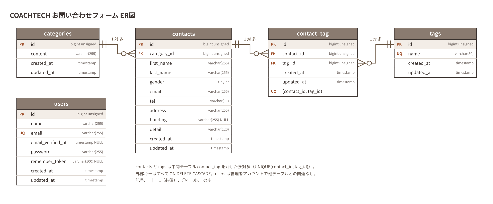
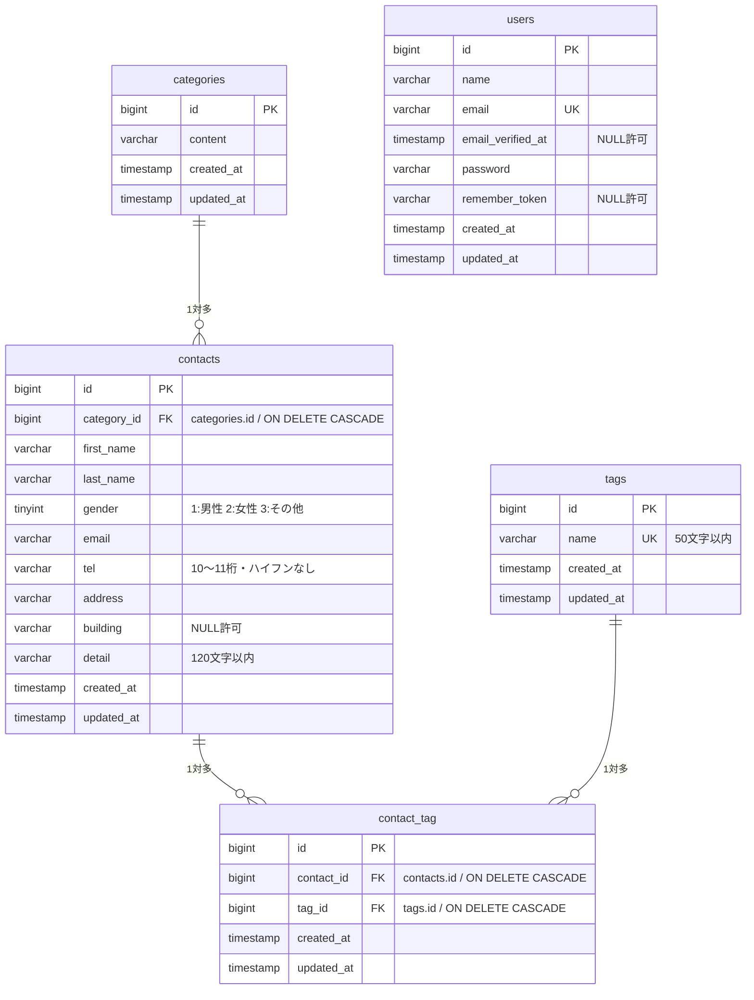

# COACHTECH お問い合わせフォーム

## 概要

一般ユーザーが利用する公開のお問い合わせフォームと、管理者がログイン後に問い合わせ内容を確認・管理する管理画面を備えた Laravel アプリケーションです。
COACHTECH 基礎学習ターム確認テストとして、教材で学んだバックエンド技術（Laravel / DB設計 / テスト）を実践的にアウトプットする目的で作成しました。

画面は Blade テンプレートとセッション認証（Cookie）で動作する Traditional Web 構成（`routes/web.php`）で、応用機能として認証不要の公開 API（`routes/api.php`）も実装しています。

### 実装機能

**お問い合わせフォーム（一般ユーザー）**

- 入力ページ（`/`）：カテゴリ（ドロップダウン）・タグ（チェックボックス・複数選択）を DB から表示
- 確認ページ（`POST /contacts/confirm`）：FormRequest でバリデーションし、性別・カテゴリ名・タグ名を文字列で表示
- 送信（`POST /contacts`）：`contacts` に保存し、選択タグを `contact_tag` に記録して `/thanks` へリダイレクト
- サンクスページ（`/thanks`）

**認証（Laravel Fortify）**

- 管理者登録（`/register`）・ログイン（`/login`、5回/分のレート制限）・ログアウト
- バリデーションメッセージは日本語（FormRequest の `messages()` と `lang/ja/auth.php`）

**管理画面（要ログイン）**

- お問い合わせ一覧（7件ごとのページネーション・新着順）
- 検索：名前（姓・名・「姓 名」の部分一致）／メールアドレス（部分一致）、性別、カテゴリ、日付。全条件の同時指定可
- 詳細表示・削除
- タグ管理：追加・編集（`/admin/tags/{tag}/edit`）・削除（関連する `contact_tag` は自動削除）
- CSV エクスポート（応用）：検索条件に一致するデータを BOM 付き CSV でダウンロード（未指定時は全件・新着順）

**公開 API（応用）**

- お問い合わせの一覧（検索・ページネーション）・詳細・作成・更新・削除
- バリデーションエラーは 422、存在しない ID は 404 を日本語メッセージの JSON で返却

## 使用技術

| 分類 | 技術 |
| --- | --- |
| 言語 | PHP 8.2 |
| フレームワーク | Laravel 10.x |
| 認証 | Laravel Fortify |
| データベース | MySQL 8.0 |
| Web サーバー | Nginx（Laravel Sail） |
| フロントエンド | Blade, Vite, Tailwind CSS ^3.4.0, Alpine.js |
| 開発環境 | Docker, Laravel Sail, phpMyAdmin |
| テスト / 品質 | PHPUnit 10, Laravel Pint |

## ER 図





- `contacts` と `tags` は中間テーブル `contact_tag` を介した**多対多**（`UNIQUE(contact_id, tag_id)`）
- `categories` と `contacts` は **1対多**
- `users` は管理画面にログインする管理者アカウントで、他テーブルとのリレーションはありません

## 環境構築手順

Docker（Docker Desktop など）がインストールされ、起動している必要があります。

### 1. リポジトリのクローン

```bash
git clone https://github.com/<GitHubユーザー名>/contact-form-app.git
cd contact-form-app
```

### 2. Composer パッケージのインストール

ローカルに PHP / Composer がなくても、Sail と同じ PHP 8.2 のコンテナでインストールできます。

```bash
docker run --rm \
    -u "$(id -u):$(id -g)" \
    -v "$(pwd):/var/www/html" \
    -w /var/www/html \
    -e COMPOSER_CACHE_DIR=/tmp/composer_cache \
    laravelsail/php82-composer:latest \
    composer install
```

### 3. 環境変数ファイルの作成

```bash
cp .env.example .env
```

`.env` のデータベース接続情報が以下になっていることを確認します（`DB_HOST` はコンテナ名の `mysql`）。

```dotenv
DB_CONNECTION=mysql
DB_HOST=mysql
DB_PORT=3306
DB_DATABASE=laravel
DB_USERNAME=sail
DB_PASSWORD=password
```

### 4. Sail の起動とエイリアス設定

```bash
./vendor/bin/sail up -d

# 'sail' だけでコマンドを実行できるようにする（zsh の場合）
echo "alias sail='[ -f sail ] && bash sail || bash vendor/bin/sail'" >> ~/.zshrc
# bash の場合
# echo "alias sail='[ -f sail ] && bash sail || bash vendor/bin/sail'" >> ~/.bashrc

exec $SHELL
```

> Apple Silicon（M1/M2/M3）の Mac でも動作するよう、`compose.yaml` の mysql サービスには `platform: 'linux/amd64'` を設定済みです。

### 5. アプリケーションキーの生成

```bash
sail artisan key:generate
```

### 6. フロントエンドのセットアップ

```bash
sail npm install
sail npm run dev
```

`sail npm run dev` は実行したままにしておきます（以降のコマンドは別のターミナルで実行してください）。
Vite 開発サーバーを起動せずに確認する場合は、代わりに `sail npm run build` を実行してください。

### 7. マイグレーションと初期データ投入

```bash
sail artisan migrate --seed
```

データベースをリセットしたい場合は `sail artisan migrate:fresh --seed` を実行します。

投入される初期データ：

| Seeder | 内容 |
| --- | --- |
| UserSeeder | 管理者 1 件（下記ログイン情報） |
| CategorySeeder | 商品のお届けについて / 商品の交換について / 商品トラブル / ショップへのお問い合わせ / その他 |
| TagSeeder | 質問 / 要望 / 不具合報告 / ご意見 / その他 |
| ContactSeeder | Faker（ja_JP）によるお問い合わせ 20 件（各 1〜3 件のタグを紐付け） |

### ログイン情報（初期管理者）

| 項目 | 値 |
| --- | --- |
| メールアドレス | test@example.com |
| パスワード | password |

## 開発環境 URL

| 画面 | URL |
| --- | --- |
| お問い合わせフォーム | http://localhost/ |
| 管理者登録 | http://localhost/register |
| ログイン | http://localhost/login |
| 管理画面 | http://localhost/admin |
| 公開 API | http://localhost/api/v1/contacts |
| phpMyAdmin | http://localhost:8080/ |

## ルーティング（Web）

| メソッド | パス | 内容 | 認証 |
| --- | --- | --- | --- |
| GET | / | お問い合わせフォーム入力ページ | 不要 |
| POST | /contacts/confirm | お問い合わせフォーム確認ページ | 不要 |
| POST | /contacts | お問い合わせ送信 | 不要 |
| GET | /thanks | サンクスページ | 不要 |
| GET | /register | 管理者登録画面（Fortify） | 不要 |
| GET | /login | ログイン画面（Fortify） | 不要 |
| POST | /logout | ログアウト（Fortify） | 必要 |
| GET | /admin | 管理画面（一覧・検索・タグ管理） | 必要 |
| GET | /admin/contacts/{contact} | お問い合わせ詳細 | 必要 |
| DELETE | /admin/contacts/{contact} | お問い合わせ削除 | 必要 |
| POST | /admin/tags | タグ追加 | 必要 |
| GET | /admin/tags/{tag}/edit | タグ編集ページ | 必要 |
| PUT | /admin/tags/{tag} | タグ更新 | 必要 |
| DELETE | /admin/tags/{tag} | タグ削除 | 必要 |
| GET | /contacts/export | CSV エクスポート | 必要 |

## API エンドポイント一覧

認証は不要です。`Accept` ヘッダーの有無にかかわらず JSON を返します。

| メソッド | パス | 概要 | 主なステータス |
| --- | --- | --- | --- |
| GET | /api/v1/contacts | お問い合わせ一覧（検索・ページネーション） | 200 / 422 |
| GET | /api/v1/contacts/{contact} | お問い合わせ詳細（カテゴリ・タグ含む） | 200 / 404 |
| POST | /api/v1/contacts | お問い合わせ新規作成（タグ紐付け） | 201 / 422 |
| PUT | /api/v1/contacts/{contact} | お問い合わせ更新（タグ同期） | 200 / 404 / 422 |
| DELETE | /api/v1/contacts/{contact} | お問い合わせ削除 | 204 / 404 |

### 一覧取得のクエリパラメータ

| パラメータ | 内容 |
| --- | --- |
| keyword | 姓・名・メールアドレスの部分一致 |
| gender | 1:男性 / 2:女性 / 3:その他（省略時は全て） |
| category_id | カテゴリ ID |
| date | 作成日（YYYY-MM-DD） |
| page | ページ番号（デフォルト 1） |
| per_page | 1 ページあたりの件数（デフォルト 20、最大 100） |

### リクエスト例

```bash
# 一覧（検索・ページネーション）
curl "http://localhost/api/v1/contacts?keyword=山田&gender=1&per_page=10"

# 作成
curl -X POST http://localhost/api/v1/contacts \
  -H "Content-Type: application/json" \
  -d '{"first_name":"山田","last_name":"太郎","gender":1,"email":"taro@example.com","tel":"09012345678","address":"東京都渋谷区1-1-1","building":"渋谷ビル301","category_id":1,"detail":"商品の配送日について","tag_ids":[1,3]}'
```

## テスト

```bash
sail artisan test
```

テストは `phpunit.xml` の設定により `testing` データベース（MySQL）で実行されます。`testing` データベースは Sail の MySQL コンテナ初回起動時に自動作成されます。

### カバレッジ

`.env` に `SAIL_XDEBUG_MODE=develop,debug,coverage` を設定済みです（`.env.example` に記載）。設定を変更した場合はコンテナを再起動してから実行してください。

```bash
sail down && sail up -d
sail artisan test --coverage
```

### 主なテスト

| 種別 | 対象 |
| --- | --- |
| Unit（バリデーション） | お問い合わせ保存・一覧検索・CSV エクスポート・タグ登録/更新・API 検索/作成 |
| Unit（モデル） | Category hasMany / Contact belongsTo・tags sync / Tag belongsToMany |
| Feature | ページ表示、確認ページ、送信、管理画面アクセス制御、検索・ページネーション、詳細、削除、タグ CRUD、CSV、認証、公開 API 5 種 |

## コードフォーマット

```bash
sail bin pint --test
```

## 作成者

片倉 一輝
